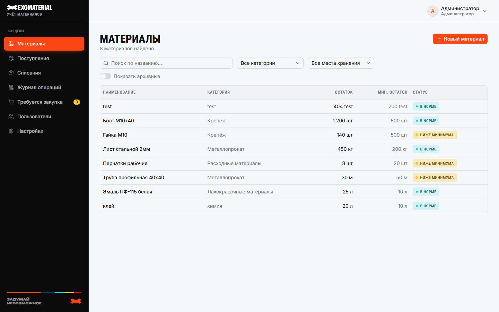
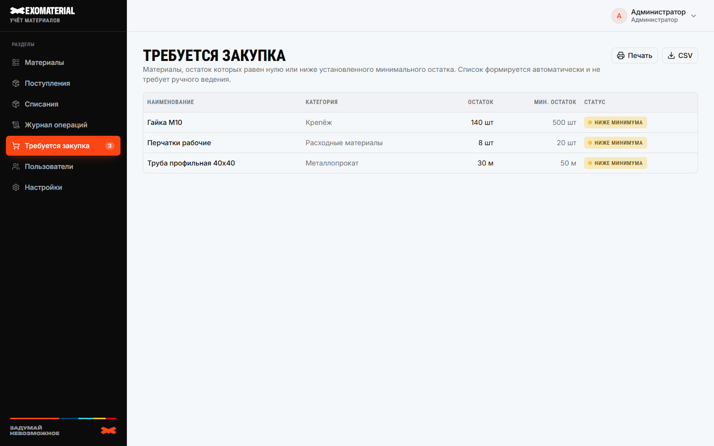
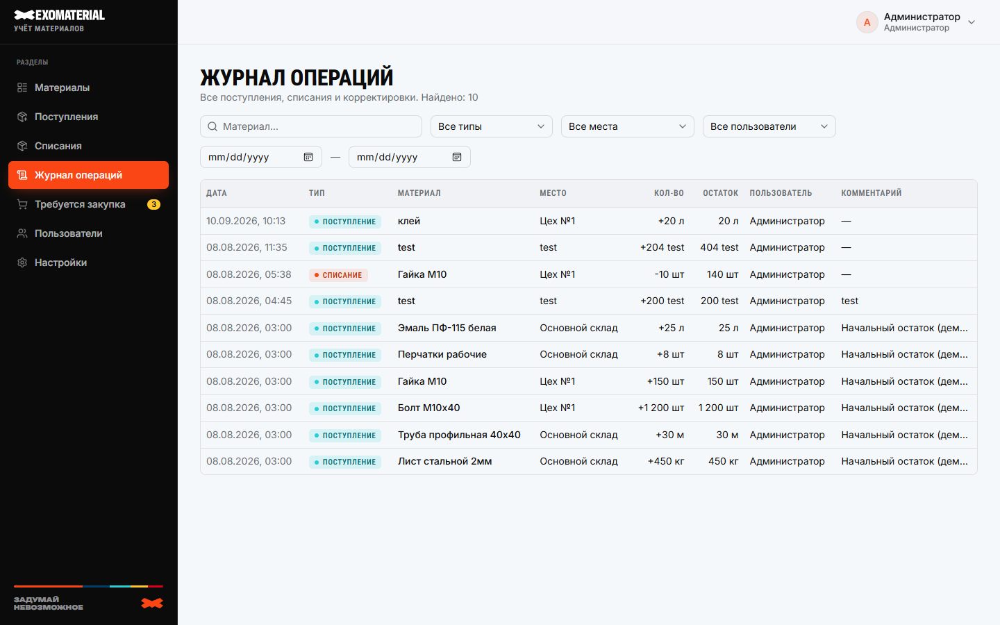

# Exomaterial — учёт материалов на производстве

**Exomaterial** — внутренняя веб-система учёта материалов для производства. Остатки по местам хранения считаются автоматически, приход и списание оформляются за минуты, а список «Требуется закупка» всегда актуален — без Excel и бумажных журналов.

Одно приложение + PostgreSQL + опциональный nginx с HTTPS. Разворачивается на своём сервере предприятия; доступ — из локальной сети, интернет не нужен.


---

## Возможности

| | |
|---|---|
| **Карточки материалов** | Наименование, категория, единица измерения, минимальный остаток, комментарий. Архив вместо удаления. |
| **Учёт по местам хранения** | Один материал — несколько складов/ячеек; общий остаток считается автоматически. |
| **Поступления и списания** | Приход с количеством, стоимостью, поставщиком и местом; списание со склада. Система **физически не даёт** списать больше, чем есть в наличии — даже при одновременной работе нескольких человек. |
| **Требуется закупка** | Автоматический список позиций ниже минимума или с нулевым остатком, печать и выгрузка CSV. |
| **Журнал операций** | Дата, пользователь, тип, количество, место, поставщик, комментарий и остаток после операции. |
| **Справочники** | Категории, единицы измерения, поставщики, места хранения — в разделе «Настройки». |
| **Роли и доступ** | Администратор и пользователь; отключение учётки без потери истории. Вход по логину и паролю (Argon2id). |
| **Адаптивный UI** | Удобно с ПК, планшета и телефона; светлая/тёмная тема. |







---

## Содержание

- [Возможности](#возможности)
- [Скриншоты](#скриншоты)
- [Требования](#требования)
- [Готовые варианты запуска](#готовые-варианты-запуска)
- [Установка на сервере](#установка-на-сервере)
- [HTTPS и сертификат](#https-и-сертификат)
- [Первый администратор](#первый-администратор)
- [Переменные окружения](#переменные-окружения)
- [Обновление и пересборка](#обновление-и-пересборка)
- [Резервное копирование](#резервное-копирование)
- [Технологии](#технологии)
- [Структура проекта](#структура-проекта)
- [Разработка](#разработка)

---

## Скриншоты

| Экран | Файл |
|---|---|
| Вход в систему | [`docs/screenshots/01-login.png`](docs/screenshots/01-login.png) |
| Материалы | [`docs/screenshots/02-materials.png`](docs/screenshots/02-materials.png) |
| Требуется закупка | [`docs/screenshots/03-purchase-list.png`](docs/screenshots/03-purchase-list.png) |
| Журнал операций | [`docs/screenshots/04-journal.png`](docs/screenshots/04-journal.png) |
| Поступления | [`docs/screenshots/05-receipts.png`](docs/screenshots/05-receipts.png) |

> `admin` / `admin` и `user` / `user` — только демонстрационные учётки для скриншотов. При установке они **не создаются**. Первый запуск начинается без пользователей: создайте администратора по инструкции ниже. Не используйте демонстрационные пароли на сервере.

---

## Требования

На сервере достаточно:

- **Docker** 24+
- **Docker Compose** (`docker compose`)

PostgreSQL и приложение поднимаются контейнерами — отдельный Node.js на хосте не нужен.

## Готовые варианты запуска

Один `docker-compose.yml` — два режима через `COMPOSE_PROFILES` в `.env` (без правки compose):

| Вариант | `COMPOSE_PROFILES` | Что поднимается | Когда |
|---|---|---|---|
| **Стандартный** | `proxy` | `db` + `app` + `proxy` (nginx, HTTPS на 80/443) | На сервере свободны 80/443 — HTTPS «из коробки» |
| **Без встроенного прокси** | *(пусто)* | только `db` + `app`, приложение на `127.0.0.1:3000` | Уже есть свой nginx/reverse proxy — направьте его на `127.0.0.1:3000` |

Сервисы в compose: **`db`** (PostgreSQL 16), **`app`** (Next.js), **`proxy`** (nginx, профиль `proxy`). Других сервисов нет.

Файл `docker-compose.override.yml` Compose подхватывает автоматически. Он публикует порт базы `5432` только на этом компьютере (`127.0.0.1`), чтобы локальный Node.js мог подключиться к Postgres. Для сервера этот порт не нужен: чтобы не загружать оверрайд, запускайте основной файл явно: `docker compose -f docker-compose.yml up -d --build`.

## Установка на Windows или Linux

Эта инструкция запускает приложение, базу и встроенный HTTPS-прокси. Перед началом установите и запустите Docker Desktop (Windows) или Docker Engine с Compose (Linux). Откройте PowerShell или терминал в папке проекта и проверьте, что Docker отвечает:

Все команды ниже выполняйте из папки проекта, где находятся `docker-compose.yml` и `.env.example`. Проверьте, что вы в нужной папке:

```powershell
Get-ChildItem docker-compose.yml, .env.example
```

В Linux используйте `ls docker-compose.yml .env.example`. Если команда сообщает, что файлы не найдены, перейдите в папку проекта и повторите её.

```text
docker --version
docker compose version
```

Если команда `docker` не найдена или Docker не запущен, сначала установите/запустите Docker и повторите проверку.

### 1. Создайте файл настроек

Скопируйте пример `.env.example` в новый файл `.env`.

PowerShell:

```powershell
Copy-Item .env.example .env
notepad .env
```

Linux:

```bash
cp .env.example .env
nano .env
```

Файл `.env` содержит пароли и секреты; не отправляйте его другим людям и не добавляйте в Git. В строках ниже заменяйте только текст справа от `=`. Не добавляйте кавычки и пробелы вокруг `=`.

### 2. Заполните четыре значения в `.env`

| Переменная | Что указать |
|---|---|
| `COMPOSE_PROFILES` | Оставьте `proxy`, чтобы использовать встроенный HTTPS-прокси. Если у вас уже есть nginx, см. вариант без прокси ниже. |
| `POSTGRES_PASSWORD` | Случайная строка из букв `a`–`f` и цифр. Её можно создать командой `docker run --rm alpine/openssl rand -hex 32`; скопируйте результат после `POSTGRES_PASSWORD=`. |
| `AUTH_SECRET` | Секрет для сессий. Создайте командой `docker run --rm alpine/openssl rand -base64 48` и скопируйте результат после `AUTH_SECRET=`. |
| `AUTH_URL` | Адрес, по которому вы будете открывать приложение. Для сервера укажите `https://` и имя/IP сервера, например `https://materials.company.local`. Для локального запуска без прокси — `http://localhost:3000`. |

Сохраните `.env`. Остальные строки оставьте без изменений. В частности, не меняйте `DATABASE_URL`: Compose сам настраивает подключение контейнера приложения к базе.

### 3. Подготовьте HTTPS-сертификат

Если `COMPOSE_PROFILES=proxy`, nginx требует сертификат перед запуском. Создайте самоподписанный сертификат по инструкции в разделе [HTTPS и сертификат](#https-и-сертификат). Имя в команде сертификата должно совпадать с именем в `AUTH_URL`. Для доверенного сертификата пропустите генерацию и положите выданные файлы в `docker/certs/server.crt` и `docker/certs/server.key`.

Если встроенный прокси не нужен, очистите значение `COMPOSE_PROFILES=` и установите `AUTH_URL=http://localhost:3000`. Не генерируйте сертификат. Этот вариант предназначен для сервера, где уже настроен собственный прокси.

### 4. Соберите и запустите приложение

```bash
docker compose up -d --build
```

Первый запуск может занять несколько минут: Docker загружает нужные компоненты и собирает приложение. Команда создаёт пустую базу, применяет миграции и запускает контейнеры.

Проверьте их состояние:

```bash
docker compose ps
```

При стандартной настройке должны быть запущены `db`, `app` и `proxy`. `db` должен показывать состояние `healthy`. Чтобы смотреть сообщения приложения, выполните `docker compose logs -f app`. Нажмите `Ctrl+C`, чтобы выйти из просмотра логов; контейнеры продолжат работать.

### 5. Создайте первого администратора

В новой базе нет пользователей. Выполните команду из раздела [Первый администратор](#первый-администратор) и задайте пароль длиной не менее 8 символов.

### 6. Откройте приложение

Откройте адрес из `AUTH_URL` в браузере. Если вы создали самоподписанный сертификат, браузер покажет предупреждение о доверии — это ожидаемо для внутренней сети. Если страница не открывается, проверьте состояние `docker compose ps` и сообщения `docker compose logs --tail=100 app proxy`.

### Если Docker сообщает `password authentication failed` для `materials_app`

Пароль `POSTGRES_PASSWORD` применяется образом PostgreSQL только при первом создании тома `db_data`. Если `.env` изменили после этого или подключили ранее созданный том, пароль роли в самой базе останется прежним, хотя Compose уже передаёт приложению новое значение. Данные при этом не повреждены.

Остановите перезапускающийся контейнер приложения, затем откройте локальную консоль PostgreSQL. В этом проекте роль базы называется `materials_app`:

```bash
docker compose stop app
docker compose exec -it -u postgres db psql -U materials_app -d materials
```

В консоли выполните `\password materials_app` и задайте пароль, совпадающий со значением `POSTGRES_PASSWORD` в `.env`. Введите `\q`, затем пересоздайте контейнер приложения, чтобы он прочитал `.env`:

```bash
docker compose up -d --force-recreate app
```

Если приложение всё ещё не подключается, проверьте, что пароль в `.env` совпадает с заданным в PostgreSQL. Compose напрямую подставляет его в URL подключения, поэтому используйте hex-пароль из `openssl rand -hex 32`, без символов URI. Удаление тома (`docker compose down -v`) также сбросит пароль при следующем создании базы, но безвозвратно удалит данные — используйте его только если база точно не нужна.

## HTTPS и сертификат

Только для `COMPOSE_PROFILES=proxy`. HTTPS терминирует сервис **`proxy`** (`nginx:alpine`): слушает 80/443, редиректит HTTP→HTTPS, проксирует на `app:3000` (`docker/nginx.conf`). Файлы `server.crt` / `server.key` монтируются из `docker/certs/` (в git не хранятся — см. `.gitignore`).

**Самоподписанный сертификат** (внутренняя сеть). Имя в `subjectAltName` должно совпадать с хостом из `AUTH_URL`; браузеры проверяют именно это поле:

```bash
openssl req -x509 -nodes -newkey rsa:2048 \
  -keyout docker/certs/server.key \
  -out docker/certs/server.crt \
  -days 825 -subj "/CN=materials.company.local" \
  -addext "subjectAltName=DNS:materials.company.local"
```

Без `openssl` на хосте:

```bash
docker run --rm -v "$(pwd)/docker/certs:/certs" alpine/openssl req -x509 -nodes -newkey rsa:2048 \
  -keyout /certs/server.key -out /certs/server.crt -days 825 \
  -subj "/CN=materials.company.local" \
  -addext "subjectAltName=DNS:materials.company.local"
```

В PowerShell запустите ту же команду через Docker:

```powershell
$certDir = (Resolve-Path .\docker\certs).Path.Replace('\', '/')
docker run --rm --mount "type=bind,source=$certDir,target=/certs" alpine/openssl req -x509 -nodes -newkey rsa:2048 `
  -keyout /certs/server.key -out /certs/server.crt -days 825 `
  -subj "/CN=materials.company.local" `
  -addext "subjectAltName=DNS:materials.company.local"
```

Если в `.env` выбран другой адрес, замените `materials.company.local` в команде на его имя. Например, для `AUTH_URL=https://localhost` используйте `localhost`.

**Свой сертификат** (внутренний УЦ / домен): положите файлы как `docker/certs/server.crt` и `docker/certs/server.key` (или обновите пути в `docker/nginx.conf`).

Перед запуском `docker compose up -d proxy` (или полного `docker compose up -d --build`) убедитесь, что оба файла существуют и имя в сертификате совпадает с `AUTH_URL`.

Если в `AUTH_URL` указан IP-адрес, замените SAN на `subjectAltName=IP:192.168.1.10`. Самоподписанный сертификат вызовет предупреждение браузера; для публичного доступа используйте сертификат, которому доверяет клиент.

> **Важно:** `AUTH_URL`, хост в `subjectAltName` и адрес, по которому пользователи открывают систему, должны совпадать. Иначе браузер покажет ошибку сертификата или Auth.js сломает callback’и сессии.

## Первый администратор

Публичной регистрации нет, а начальная база не содержит пользователей. Создайте администратора из контейнера:

```bash
docker compose exec -it app npm run create-admin
```

Скрипт спросит ФИО, логин и пароль (минимум 8 символов). Неинтерактивно:

```bash
docker compose exec app npm run create-admin -- \
  --full-name="Иван Иванов" --login=admin --password="ЗамениНаНадёжныйПароль"
```

Дальше:

1. Войдите под созданной учёткой.
2. **Пользователи** — заведите остальных сотрудников.
3. **Настройки** — категории, единицы, поставщики, места хранения.
4. **Материалы** и **Поступления** — каталог и фактические остатки.

Повторный `create-admin` с занятым логином отклоняется — дальше управляйте через UI.

## Переменные окружения

Полный список — в [`.env.example`](.env.example). Кратко:

| Переменная | Назначение |
|---|---|
| `COMPOSE_PROFILES` | `proxy` или пусто — см. варианты запуска |
| `POSTGRES_PASSWORD` | Пароль PostgreSQL внутри Docker-сети |
| `AUTH_SECRET` | Секрет подписи сессионных cookie (длинный, случайный) |
| `AUTH_URL` | Публичный URL системы с `https://` (или `http://localhost:3000` в разработке) |
| `DATABASE_URL` | Подключение к БД для скриптов **вне** Docker |
| `NODE_ENV` | В Compose для `app` задаётся `production` |

Секреты живут только в окружении / `.env`, не в исходниках.

## Обновление и пересборка

**Полное обновление** (код + образ приложения; БД и том `db_data` сохраняются):

```bash
git pull
docker compose up -d --build
```

Миграции применяются при старте контейнера `app` (`docker/entrypoint.sh`). Материалы, остатки, журнал и пользователи не теряются.

**Пересборка только приложения** (типичный случай после правок UI/логики — без трогания БД и nginx):

```bash
docker compose up -d --build app
```

Том `db_data` и конфиг `docker/nginx.conf` при этом не затрагиваются. Перезапускать `proxy` нужно только если меняли сертификаты или `nginx.conf`.

## Резервное копирование

```bash
docker compose exec db pg_dump -U materials_app materials > backup_$(date +%Y-%m-%d).sql
```

Храните дампы отдельно от сервера (диск / файловый шаринг). Восстановление:

```bash
cat backup_2026-08-08.sql | docker compose exec -T db psql -U materials_app -d materials
```

## Технологии

- **Next.js** + **React** + **TypeScript** — UI и сервер в одном проекте
- **PostgreSQL 16** — данные
- **Drizzle ORM** — схема и миграции
- **Auth.js** — сессии; пароли — **Argon2id**
- **shadcn/ui** + **Tailwind CSS** — интерфейс
- **Docker Compose** — `db` + `app` + опциональный `proxy` (nginx HTTPS)

## Структура проекта

```
├── docker/
│   ├── certs/              # TLS для nginx (не в git)
│   ├── nginx.conf          # HTTPS → app:3000
│   ├── entrypoint.sh       # db:migrate → npm start
│   └── init-extensions.sql # расширения Postgres при первом старте тома
├── docs/screenshots/       # скриншоты для README
├── drizzle/                # SQL-миграции
├── src/
│   ├── app/                # страницы (App Router)
│   ├── components/         # UI
│   ├── db/                 # схема, migrate, create-admin
│   ├── lib/                # auth, валидация, утилиты
│   └── server/             # actions + services
├── Dockerfile
├── docker-compose.yml      # db + app + proxy (profile)
├── docker-compose.override.yml  # локальная разработка (порт 5432 только на localhost)
└── .env.example
```

## Разработка

Для доработки кода (не для прод-сервера). Нужны Node.js 22+ и Docker (для Postgres).

```bash
npm install
cp .env.example .env
# Для локальной разработки без HTTPS:
#   AUTH_URL=http://localhost:3000
#   COMPOSE_PROFILES=   (пусто)

docker compose -f docker-compose.yml -f docker-compose.override.yml up -d db

npm run db:migrate
npm run create-admin
npm run dev
```

Полезные команды:

```bash
npm run lint
npm run build
npm run test
npm run db:generate    # после изменения src/db/schema.ts
npm run db:studio
npm run create-admin
```

Compose автоматически подхватывает `docker-compose.override.yml`; он открывает Postgres только на `127.0.0.1:5432`, недоступном с других компьютеров. Для сервера используйте только основной файл: `docker compose -f docker-compose.yml up -d --build`. Для локальной разработки этот оверрайд позволяет подключиться к Postgres с хоста через `localhost:5432`.
